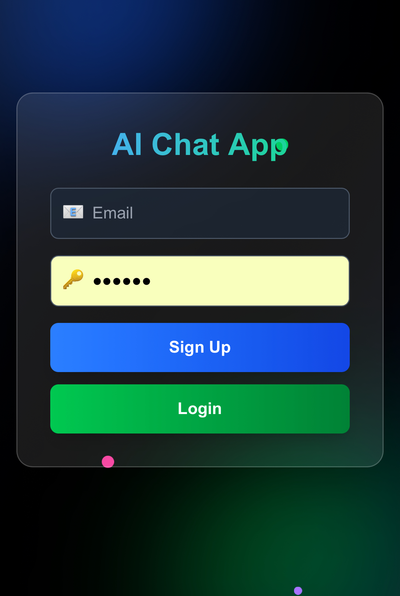
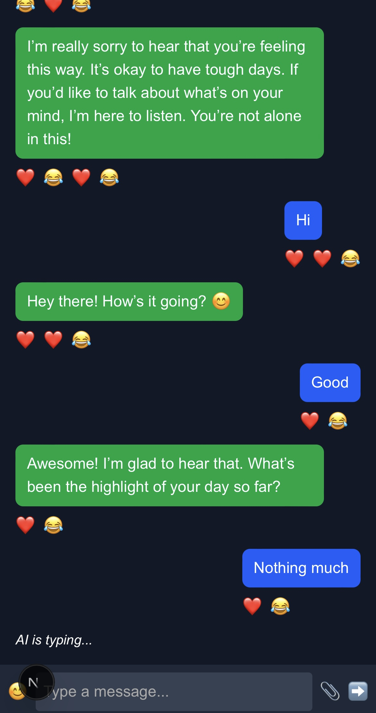
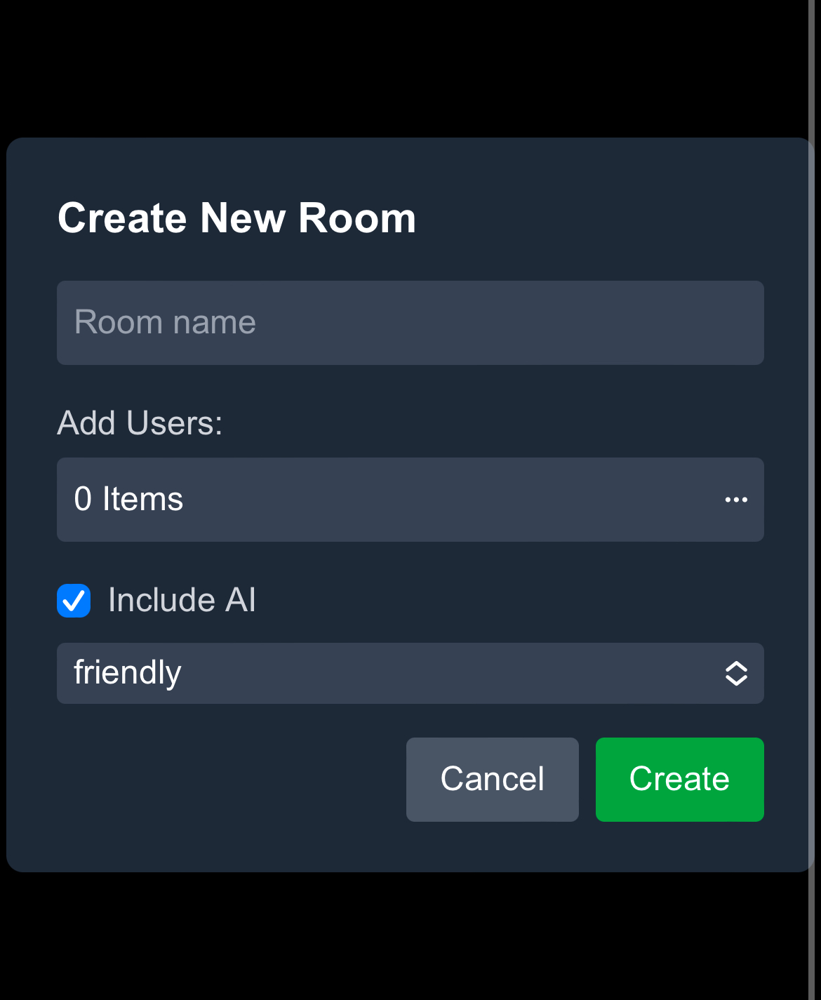

# AI Chat App

A real time chat app with an AI assistant built in. You can create group rooms, share images, react to messages and ask the assistant (OpenAI's GPT-4o mini) questions without leaving the chat. It's built with Next.js, Firebase and Tailwind CSS.

Live demo: https://ai-chat-app-ochre-sigma.vercel.app

## Screenshots

| Login | Chat | Room modal |
| --- | --- | --- |
|  |  |  |

## Features

- Email and password sign in with Firebase Authentication.
- Messages sync instantly for everyone in the chat through Firestore.
- An AI assistant powered by GPT-4o mini, with replies that stream in as they're written.
- Group rooms: create a room, add members and chat together.
- Image sharing with a preview in the chat.
- Emoji reactions on any message.
- Edit or delete your messages from a context menu.
- Typing indicators for people and for the AI.
- Works on mobile and desktop.

## How it's built

Next.js (App Router) handles both the pages and the API. Requests to the AI go through an API route (`src/app/api/ai/route.js`), so the OpenAI key stays on the server, and a custom hook (`useAI.js`) handles the streamed replies. Firebase Authentication handles accounts and Firestore stores the messages. It's deployed on Vercel.

## Run it locally

You'll need Node.js 18 or newer, a Firebase project with Firestore and Authentication turned on, and an OpenAI API key.

```bash
git clone https://github.com/Aisha-Aliyu/ai-chat-app.git
cd ai-chat-app
npm install
```

Create a `.env.local` file in the project root:

```env
NEXT_PUBLIC_FIREBASE_API_KEY=your_firebase_api_key
NEXT_PUBLIC_FIREBASE_AUTH_DOMAIN=your_project.firebaseapp.com
NEXT_PUBLIC_FIREBASE_PROJECT_ID=your_project_id
NEXT_PUBLIC_FIREBASE_STORAGE_BUCKET=your_project.appspot.com
NEXT_PUBLIC_FIREBASE_MESSAGING_SENDER_ID=your_sender_id
NEXT_PUBLIC_FIREBASE_APP_ID=your_app_id
OPENAI_API_KEY=your_openai_api_key
```

Then run `npm run dev` and open http://localhost:3000. To deploy on Vercel, add the same variables in the project's environment settings.

## What I'd add next

Push notifications, voice messages, a choice of AI personalities, end to end encryption and message search.

## Contact

Aisha Aliyu, full stack and frontend engineer

- Portfolio: https://humairah.netlify.app
- LinkedIn: https://www.linkedin.com/in/aisha-aliyu-dev
- GitHub: https://github.com/Aisha-Aliyu

License: MIT
