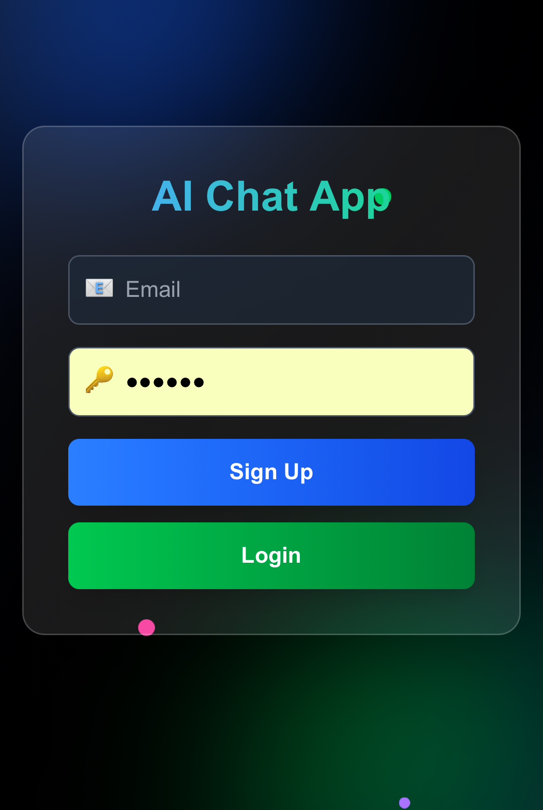
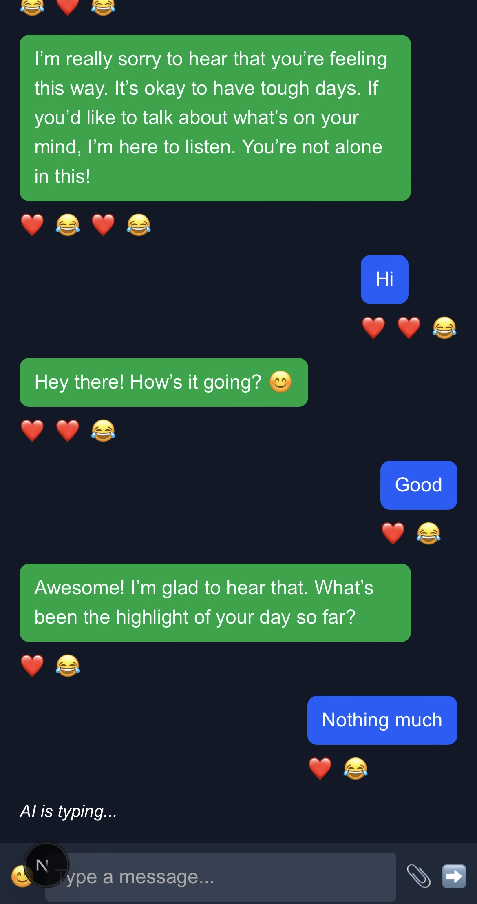
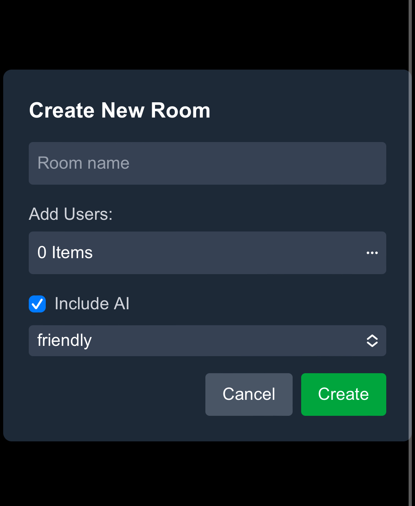

# 🤖 AI Chat App

> A full-stack, real-time AI-powered chat platform built with Next.js 14, Firebase, and OpenAI GPT-4o-mini.

[](https://ai-chat-app-ochre-sigma.vercel.app/)
[](https://nextjs.org/)
[](https://firebase.google.com/)
[](https://platform.openai.com/)
[](https://tailwindcss.com/)

-----

## 📸 Screenshots

|Login                                          |Chat                                         |Room Modal                                  |
|-----------------------------------------------|---------------------------------------------|--------------------------------------------|
||||

-----

## ✨ Features

- 🔑 **Authentication** — Secure email/password login via Firebase Auth
- 💬 **Real-time Messaging** — Messages sync instantly across all connected clients via Firestore
- 🤖 **AI Assistant** — Integrated OpenAI GPT-4o-mini chatbot with streaming responses
- 👥 **Group Chats** — Create rooms, add members, and collaborate in real time
- 📎 **File Sharing** — Upload and preview images directly in chat
- 😀 **Emoji Reactions** — React to any message with an emoji picker
- ✏️ **Edit & Delete** — Context menu for message management (long-press style like ChatGPT)
- 🔔 **Typing Indicators** — Live “is typing…” indicators for both users and AI
- 📱 **Fully Responsive** — Optimised for mobile and desktop viewports
- 🎨 **Modern UI** — Tailwind CSS with custom animations and smooth transitions

-----

## 🛠️ Tech Stack

|Layer      |Technology             |
|-----------|-----------------------|
|Framework  |Next.js 14 (App Router)|
|Frontend   |React, Tailwind CSS    |
|Backend/API|Next.js API Routes     |
|Auth       |Firebase Authentication|
|Database   |Firebase Firestore     |
|AI         |OpenAI GPT-4o-mini     |
|Deployment |Vercel                 |

-----

## 📂 Project Structure

```
src/app/
├─ api/ai/route.js        # AI API endpoint (calls OpenAI)
├─ chat/page.jsx          # Main chat page
├─ components/            # ChatWindow, Sidebar, RoomModal, etc.
├─ hooks/useAI.js         # Custom hook for AI messages & streaming
├─ login/page.js          # Authentication page
├─ globals.css            # Global styles
├─ layout.js              # Root layout + metadata
└─ page.js                # Landing page

src/lib/firebase.js       # Firebase configuration
public/                   # Icons, screenshots, favicons
```

-----

## ⚙️ Getting Started

### Prerequisites

- Node.js 18+
- A Firebase project with Firestore and Authentication enabled
- An OpenAI API key

### 1. Clone the repo

```bash
git clone https://github.com/Aisha-Aliyu/ai-chat-app.git
cd ai-chat-app
```

### 2. Install dependencies

```bash
npm install
```

### 3. Configure environment variables

Create a `.env.local` file in the root:

```env
NEXT_PUBLIC_FIREBASE_API_KEY=your_firebase_api_key
NEXT_PUBLIC_FIREBASE_AUTH_DOMAIN=your_project.firebaseapp.com
NEXT_PUBLIC_FIREBASE_PROJECT_ID=your_project_id
NEXT_PUBLIC_FIREBASE_STORAGE_BUCKET=your_project.appspot.com
NEXT_PUBLIC_FIREBASE_MESSAGING_SENDER_ID=your_sender_id
NEXT_PUBLIC_FIREBASE_APP_ID=your_app_id

OPENAI_API_KEY=your_openai_api_key
```

### 4. Run locally

```bash
npm run dev
```

Open <http://localhost:3000> in your browser.

-----

## 🚀 Deployment

This app is deployed on **Vercel**:

1. Push your code to GitHub
1. Import the repo into [Vercel](https://vercel.com/)
1. Add all `.env.local` variables in the Vercel dashboard
1. Deploy — done ✅

-----

## 🗺️ Roadmap

- [ ] Push notifications
- [ ] Voice messages
- [ ] AI personality selector
- [ ] End-to-end encryption
- [ ] Message search

-----

## 👩‍💻 Author

**Aisha Aliyu** — Full-Stack & Frontend Engineer

- 🌐 Portfolio: [humairah.netlify.app](https://humairah.netlify.app)
- 💼 LinkedIn: [https://www.linkedin.com/in/aisha-aliyu-dev](https://www.linkedin.com/in/aisha-aliyu-dev)
- 🐙 GitHub: [@Aisha-Aliyu](https://github.com/Aisha-Aliyu)

-----

## 📜 License

This project is licensed under the [MIT License](./LICENSE) — free to use, modify, and distribute.
